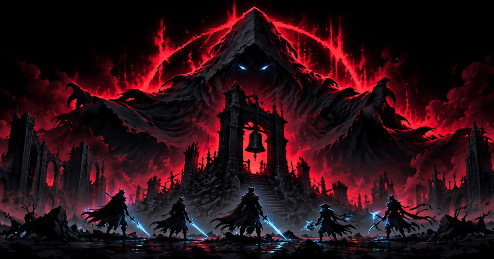
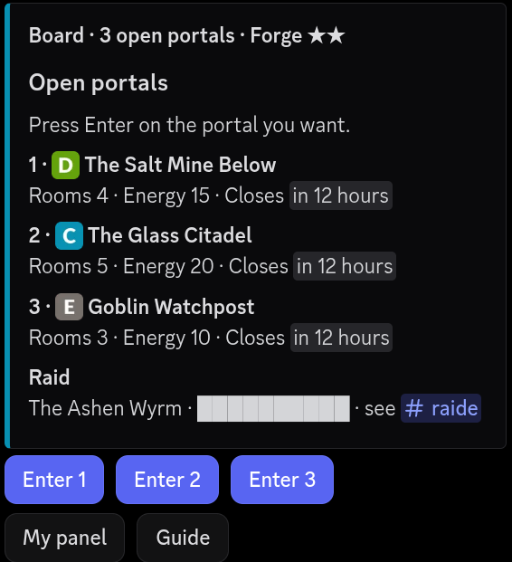
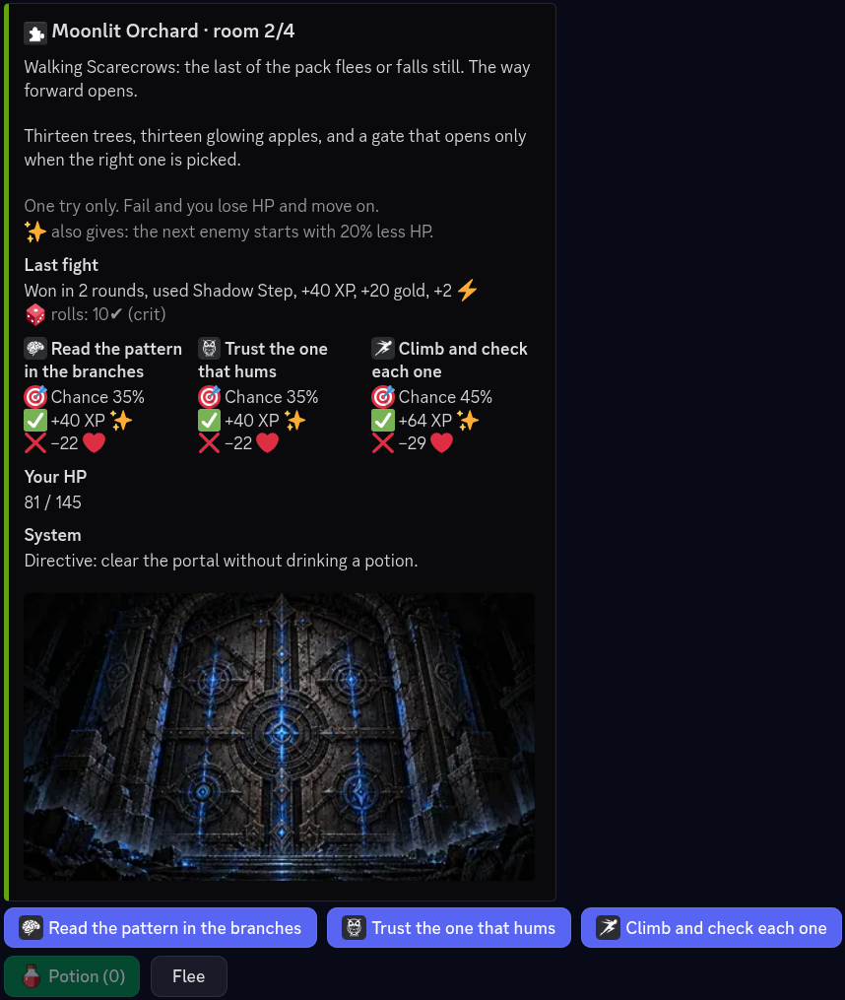

# Wakebound

**A dark RPG inside Discord. Clear portals alone. Bring the whole server down on one boss.**

[Website](https://wakebound.github.io) · [Add to Discord](https://discord.com/oauth2/authorize?client_id=1557056806734274600&scope=bot+applications.commands&permissions=117760) · [Support server](https://discord.gg/FdBgeCAYnz) · [Privacy](https://wakebound.github.io/privacy/) · [Terms](https://wakebound.github.io/terms/)

## About

Wakebound is a text-and-buttons RPG that runs in your Discord server. Portals open in a channel, hunters clear them solo or team up on raid bosses, and the whole thing plays out in messages and buttons. It is free, takes about a minute to set up, and never asks for the Administrator permission.

  
  

## Get started

1. [Add Wakebound to your server](https://discord.com/oauth2/authorize?client_id=1557056806734274600&scope=bot+applications.commands&permissions=117760).
2. A server admin runs `/config` and picks the channel for portals.
3. Players run `/awaken`, choose a class and press **Enter** on a portal. `/guide` explains the rest.

Available in English and Brazilian Portuguese. Questions and bug reports go to the [support server](https://discord.gg/FdBgeCAYnz).

## Credits

- Game icons by Lorc, Skoll, Delapouite and Faithtoken from [game-icons.net](https://game-icons.net), licensed [CC BY 3.0](https://creativecommons.org/licenses/by/3.0/).
- Fonts [Grenze](https://fontsource.org/fonts/grenze), [Alegreya Sans](https://fontsource.org/fonts/alegreya-sans) and [IBM Plex Mono](https://fontsource.org/fonts/ibm-plex-mono), under the SIL Open Font License.
- Built with [Astro](https://astro.build) and hosted on GitHub Pages.

## Legal

This repository holds the public website only; the game itself is closed source. Unless stated otherwise, the art, text and game content are all rights reserved. See the [privacy policy](https://wakebound.github.io/privacy/) and [terms](https://wakebound.github.io/terms/).
